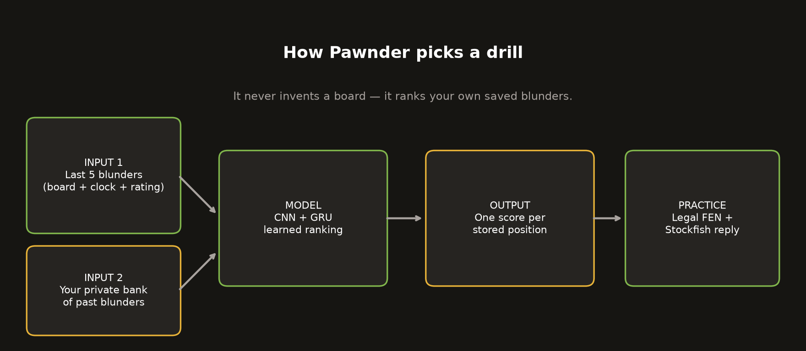
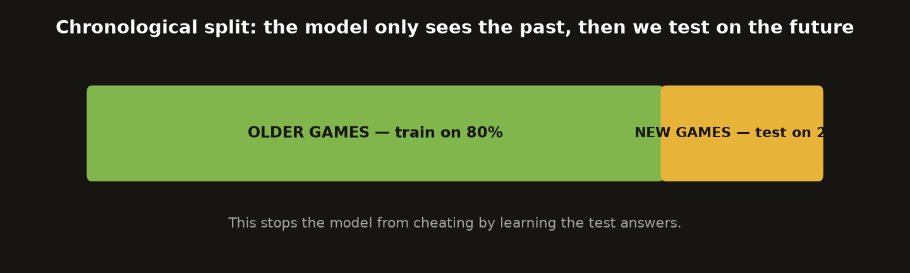
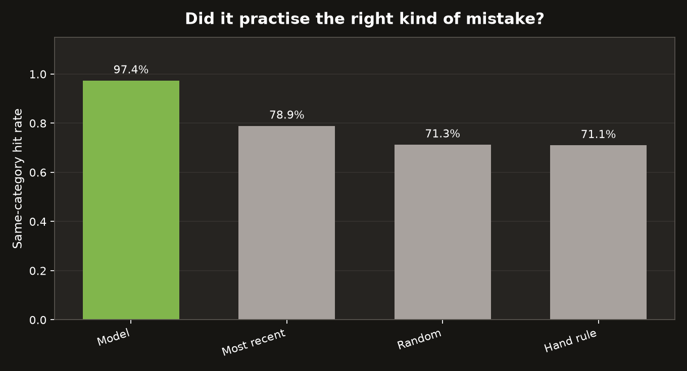
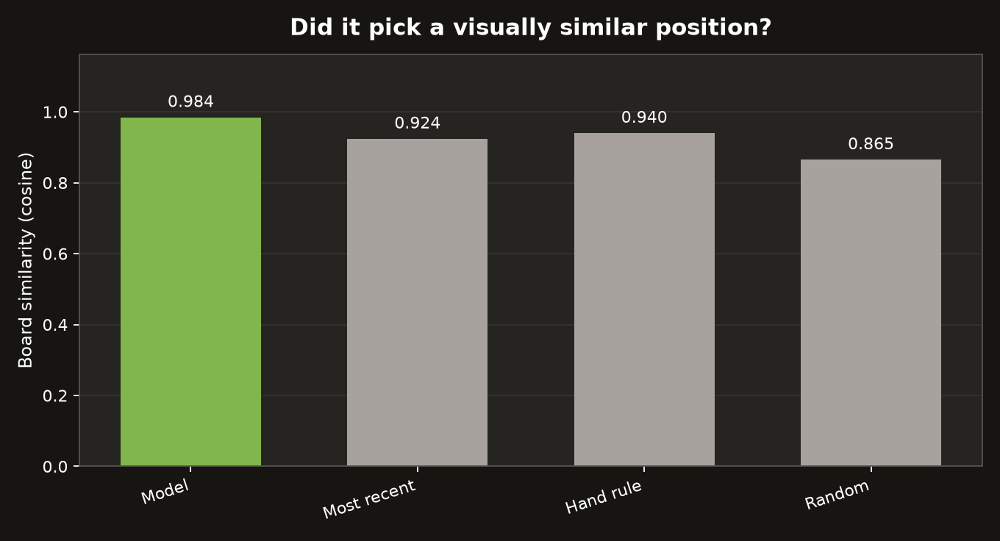
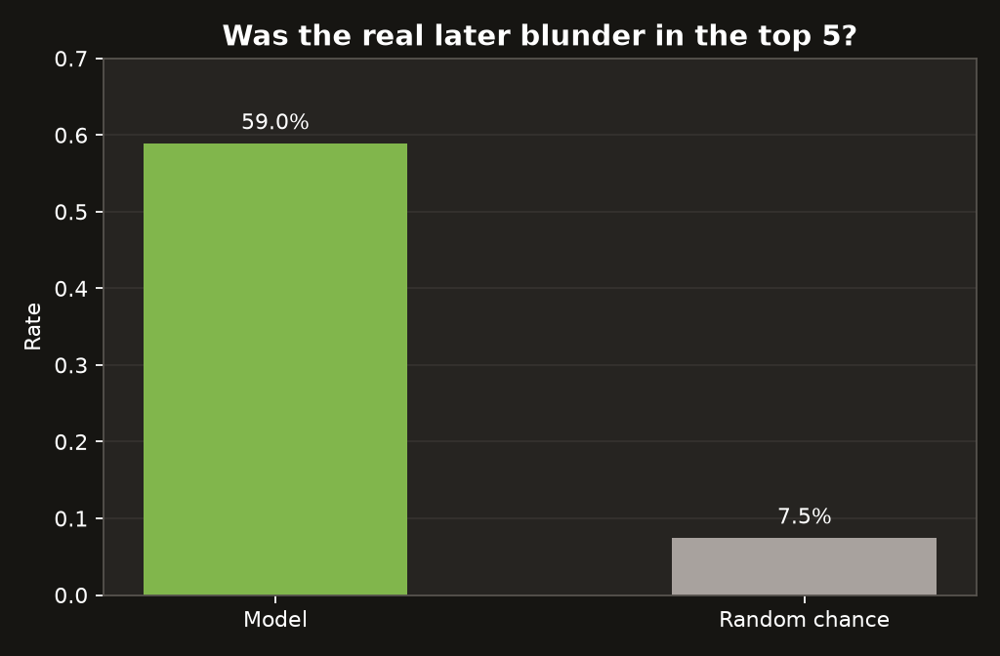

# Pawnder model — explained like you're 12

This is the simple version. The serious version with exact numbers is in
[`MODEL_JUSTIFICATION.md`](MODEL_JUSTIFICATION.md).

## The one-sentence idea

> Pawnder is like Netflix, but instead of recommending films, it recommends
> **one of your own past chess mistakes** to practise again.

It does **not** draw a new chess position. It never makes up a board. It only
picks from blunders that really happened in **your** Chess.com games.



---

## What goes in

Two things:

1. **Your last 5 blunders.** For each one, the model sees:
   - the board,
   - how much time was left,
   - roughly how strong the opponent was,
   - how late in the game it was.

2. **Your private box of old blunders.** This is only your own stuff. Nobody
   else's positions are in your box.

## What comes out

The model gives **one score to every position in your box**.

The highest score means:

> “This old mistake looks most like the kind of mistake you are making now.”

The app then picks one of the high-scoring positions and you play it against
Stockfish.

The two extra guesses the model makes — time pressure and opponent strength —
are just practice homework for the model. They do not choose the final board.
The final board's clock and Elo come from the chosen stored position.

---

## Why not just make a brand-new board from scratch?

Because making a legal chess position is surprisingly hard. The model would
have to decide all 64 squares, whose turn it is, castling rights, and whether
the kings are safe. With our small dataset it would invent illegal nonsense.

Retrieving a real position means:

- the board is always legal,
- the blunder really happened,
- Stockfish can always reply.

That guarantee is worth keeping.

---

## Where Lichess fits in

Lichess games are **not** shown to players. Chess.com stays the only
player-facing source.

Think of Lichess as a **practice textbook for the model**, not a menu for the
user:

> The student never reads the textbook. The model reads it before it meets the
> student, so it recognises chess patterns better.

Right now the Lichess data teaches the model's GRU and time/opponent heads.
Those heads are the "context" part of the brain. They are not the main ranking
signal, which is why Lichess is useful but not the star of the show.

We tried making Lichess train the board-picture part too. With only 72 training
pairs it made every board look the same to the model and the results got worse,
so we removed it. **More Lichess accounts would mean a bigger textbook** —
hundreds of blunders instead of 85 — and only then would that experiment be
worth retrying.

### What "hybrid" means

Hybrid means:

1. model first says “I think you need a time-pressure tactical drill”;
2. app then picks a legal stored FEN matching that description.

On screen it looks almost identical to what we already do, because the board
still comes from a real stored position. That is why it does not feel like a big
change. We did not add it because it would add complexity without clearly
better drills on our current data.

---

## How we checked that it works

We did not guess. We did not run an A/B test.

We took each player's games in time order and cut them:



The model learned from the older games. We then asked it to pick drills for the
newer games it had never seen. We compared it to four simple ways of picking:

- random,
- the most recent blunder,
- a clock/rating hand rule,
- always the most common category.

### Did it pick the right *kind* of mistake?



**97.4%** of the time the model picked a drill from the same failure category as
the player's later real blunder. The simple methods were around 71–79%.

### Did it pick a board that looked like the real later blunder?



Similarity **0.984** for the model vs **0.865** for random. Think of 1.0 as
“almost the same board shape”.

### Was the real answer somewhere in its top 5?



**58.9%** versus about **7.5%** chance.

---

## What this does **not** mean

- It does **not** mean we can guess the exact next FEN. We cannot — that score
  is 0%.
- It does **not** mean users got better at chess. We did not run a live study.
- It does **not** mean the private fine-tune is magic. On this small data, the
  Lichess-pretrained model scores the same as the private one. Personalisation
  comes from your **private box of blunders**, not from a huge personal brain.

The honest claim is small but real:

> Given a user's own past blunders, the model chooses a more relevant practice
> position than random, most-recent, or a simple rule — and we measured that on
> later games it had never seen.

---

## Graphs are generated from the metrics file

If the metrics change, rebuild the pictures with:

```powershell
.\.venv\Scripts\python.exe scripts\generate_model_figures.py
```

The PNGs live in `docs/images/` and are committed to the repository.
